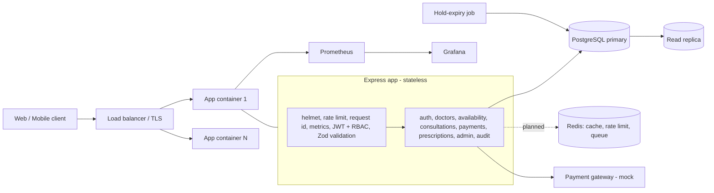
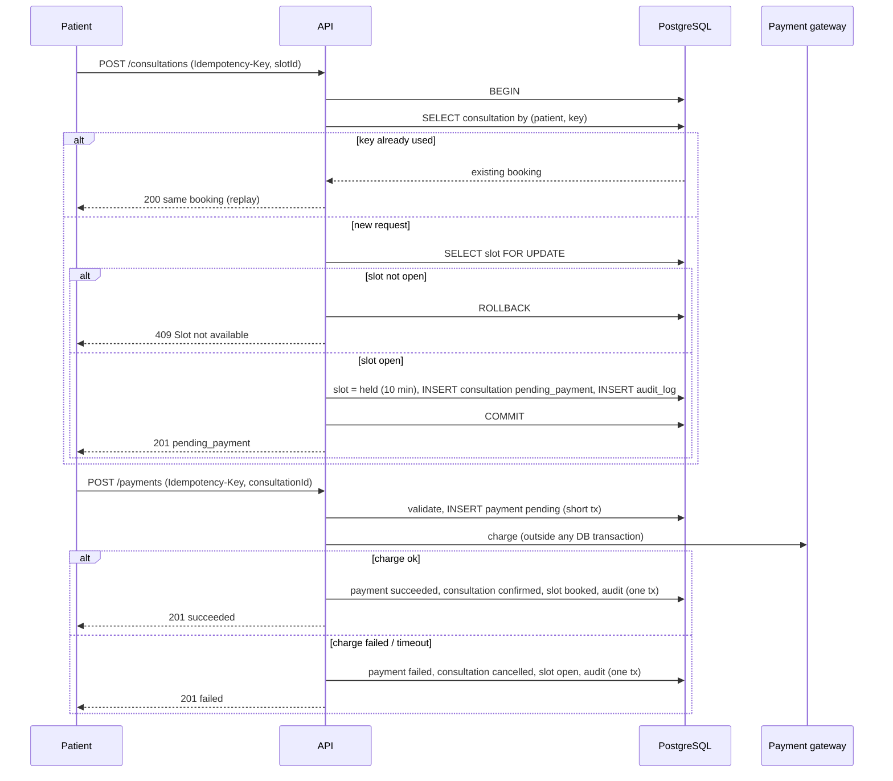
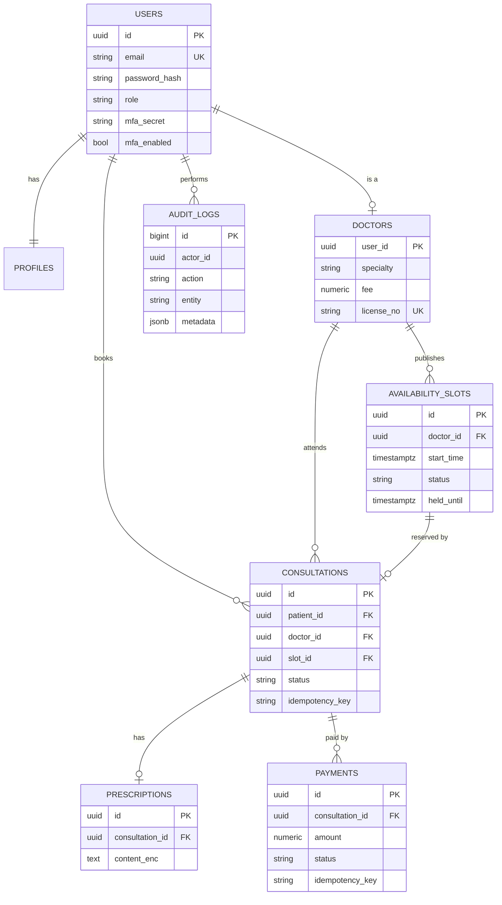

# Architecture: Amrutam Telemedicine Backend

## 1. Goals and scale

| Requirement | Target | How it is addressed |
|---|---|---|
| Load | 100k consultations/day | About 1.2 req/s average, about 15 req/s at 10x peak. One Postgres primary handles this easily, so the design focuses on correctness first and horizontal scale second. |
| Latency | p95 < 200 ms reads, < 500 ms writes | Indexed queries, short transactions, no external calls inside a DB transaction, latency histogram to verify. |
| Availability | 99.95% (about 4.4 h downtime/year) | Stateless app containers behind a load balancer, health checks, graceful shutdown, managed Postgres with replica and failover. |
| Security | Encryption, MFA, RBAC | See `docs/security.md`. |
| Observability | Metrics, logs, traces | Prometheus metrics, JSON logs with request IDs, OpenTelemetry planned. |

## 2. High-level architecture

The system is a **modular monolith**: one deployable, split into modules with clear boundaries (routes, service, schemas per module). This keeps operations simple at this scale. Each module can be extracted into a service later because modules talk through service functions and share data only through the database.

**Data flow (read):** client -> JWT check -> validated query -> indexed SELECT -> JSON.
**Data flow (write):** client -> JWT + role check -> validation -> idempotency check -> transaction with row lock -> audit row in same transaction -> commit -> response.

## 3. Booking flow (sequence)

## 4. ER diagram

Key constraints:
- `UNIQUE (doctor_id, start_time)` on slots: re-sending slot creation never duplicates.
- Partial unique index `uniq_active_consultation_per_slot ON consultations(slot_id) WHERE status <> 'cancelled'`: at most one active booking per slot, enforced by the database.
- `UNIQUE (patient_id, idempotency_key)` on consultations and `UNIQUE (consultation_id, idempotency_key)` on payments.
- `UNIQUE (consultation_id)` on prescriptions.

## 5. API schema

REST, described in `docs/openapi.yaml`. Conventions: JSON, `Authorization: Bearer`, `Idempotency-Key` header on booking and payment, errors as `{ "error": "..." }` with 400 (validation), 401, 403, 404, 409 (conflict/slot taken), 429 (rate limit).

## 6. Retry and backoff strategy

| Where | Strategy |
|---|---|
| Client -> API (booking, payment) | Safe to retry because of idempotency keys. Client retries on network error/5xx with exponential backoff and jitter: delay = min(cap, base * 2^n) + random(0..base), for example base 200 ms, cap 5 s, max 5 tries. Same key on every retry. |
| API -> payment gateway | Single attempt with a timeout inside the request. On timeout the saga compensates (releases the slot). A real gateway integration retries with backoff using the gateway's own idempotency key (we already send one). |
| DB serialization/deadlock errors | Transactions are short and lock one row in a fixed order, so conflicts are rare. Retry up to 3 times with 50-200 ms jittered delay if Postgres returns `40001` or `40P01`. |
| Background jobs | Hold-expiry runs every minute and is idempotent (it only touches rows whose hold has expired), so a missed or repeated run is harmless. With a queue (BullMQ), failed jobs retry with exponential backoff and a dead-letter list. |

## 7. Data partitioning

At 100k consultations/day the data grows about 36M rows/year, which one Postgres instance holds comfortably with proper indexes. Plan by growth stage:

1. **Now:** single tables with indexes `(patient_id, created_at DESC)`, `(doctor_id, created_at DESC)`, partial index on open slots `(doctor_id, start_time) WHERE status = 'open'`.
2. **`audit_logs` (fastest growing, append-only):** range partition by month on `created_at` (primary key becomes `(id, created_at)`). Old partitions are detached and archived to cold storage, which also satisfies retention requirements.
3. **`consultations`:** range partition by `created_at` once it passes about 100M rows. Postgres requires the partition key in unique indexes, so the "one active booking per slot" guarantee then relies on the slot row lock plus slot status (`held`/`booked`), which already is the primary mechanism. The unique index is the second safety net.
4. **Beyond that:** read replicas for search and analytics, then shard by region/doctor if needed.

## 8. Caching and concurrency

**Concurrency control (implemented):**
- Pessimistic row lock (`SELECT ... FOR UPDATE`) on the slot: concurrent requests for the same slot serialize, the loser sees `held` and gets 409.
- Partial unique index as a backstop. Tested: 10 simultaneous bookings, exactly 1 succeeds.
- Idempotency keys make retries safe. Compare-and-set style updates (`UPDATE ... WHERE status = 'confirmed'`) guard consultation state transitions.

**Caching (planned, Redis is already in docker-compose):**
- Doctor search results and a doctor's open-slot list: short TTL (30-60 s), invalidated on slot create/delete/book. Slots are always re-checked under lock at booking time, so a stale cache can never cause a double booking, only a 409.
- Rate-limit counters in Redis so limits are shared across app instances (currently in-memory per instance).
- Idempotency-key fast path and the job queue.

## 9. Transactions and sagas

The booking is a **saga with an orchestrated compensation**:

| Step | Action | Compensation |
|---|---|---|
| 1 | Hold slot + create consultation (one DB transaction) | Hold-expiry job releases it after 10 min |
| 2 | Create payment record (pending) | Marked failed |
| 3 | Charge gateway (no DB lock held) | none needed |
| 4a | Success: payment succeeded, consultation confirmed, slot booked (one transaction) | n/a |
| 4b | Failure/timeout: payment failed, consultation cancelled, slot reopened (one transaction) | n/a |

Rules: never call an external service inside a DB transaction; every state change and its audit row commit together; every step is idempotent so a crash and retry converges to the same state. A crash between steps 3 and 4 leaves `pending_payment`; the hold-expiry job and a payment reconciliation job (planned) resolve it.

## 10. Observability

- **Metrics:** `/metrics` (Prometheus): `http_requests_total`, `http_request_duration_seconds` histogram with buckets around 200 ms and 500 ms, default Node metrics. p95 query: `histogram_quantile(0.95, sum(rate(http_request_duration_seconds_bucket[5m])) by (le))`. Route labels use patterns (`/consultations/:id`) to keep cardinality bounded.
- **Logs:** structured JSON (pino) with `X-Request-Id` on every request and response.
- **Traces:** OpenTelemetry is planned; request IDs already give correlation across logs.
- **Alerts (planned):** p95 > target, 5xx rate, DB connection saturation, hold-expiry job failures.

## 11. Backup and disaster recovery

| Item | Approach |
|---|---|
| Backups | Daily full backup plus continuous WAL archiving (point-in-time recovery). Retained 30 days, copied to a second region. |
| RPO / RTO | RPO under 5 minutes (WAL shipping), RTO under 30 minutes. |
| High availability | Primary with synchronous or near-synchronous standby and automatic failover; stateless app containers across at least two zones. |
| Restore drills | Monthly restore into a staging environment, verified with the test suite. |
| Secrets and keys | Stored in a secrets manager, not in the repo. Encryption key rotation: new key id stored with each ciphertext, re-encrypt in a background job (see security doc). |
| Application recovery | Containers are immutable and rebuilt from CI; migrations are forward-only and run at startup. |

## 12. Implemented vs planned

| Area | Status |
|---|---|
| Auth, RBAC, MFA code, validation, rate limit (per instance) | Implemented |
| Booking with lock + idempotency, payment saga, hold expiry | Implemented and tested |
| Encrypted prescriptions, audit logs, admin analytics | Implemented |
| Metrics, request IDs, Docker, compose, CI | Implemented |
| Redis cache and shared rate limit, BullMQ, OpenTelemetry | Planned |
| Partitioning, read replica, backup automation | Designed (this document) |